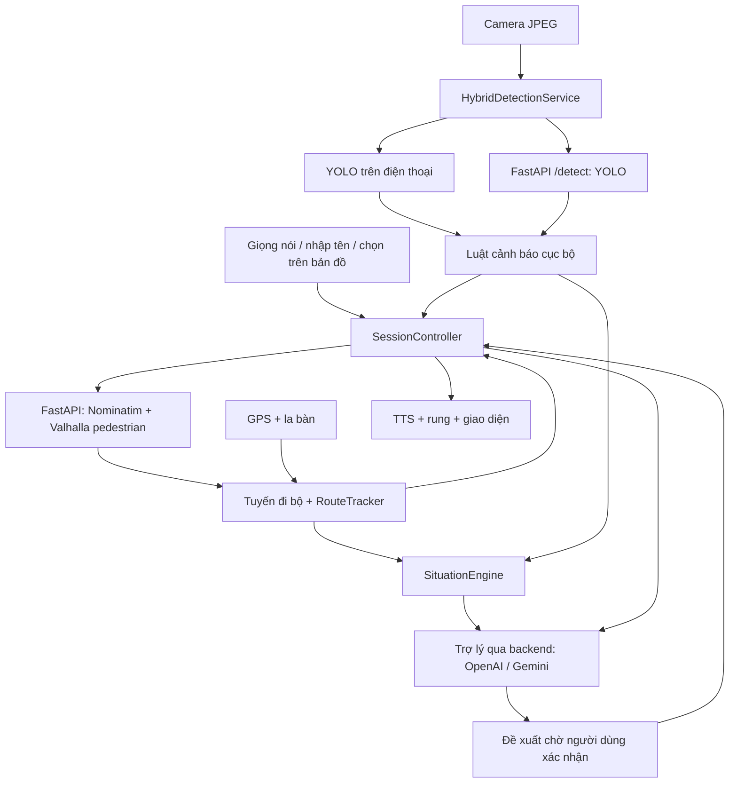

# Smart Navigation — hỗ trợ người khiếm thị đi bộ

Smart Navigation là ứng dụng Flutter cho Android, kết hợp dẫn đường bằng giọng nói,
nhận diện vật cản qua camera và trợ lý AI theo ngữ cảnh. Người dùng có thể nói điểm
đến, xác nhận địa điểm và nhận chỉ dẫn từ GPS, la bàn cùng tuyến đi bộ trên bản đồ.
Camera chạy song song để thông báo một số đối tượng trong khung hình.

**Trạng thái:** nguyên mẫu phục vụ học thuật và thử nghiệm. Các chức năng dưới đây
đã có trong mã nguồn; chưa được kiểm chứng để bảo đảm an toàn di chuyển ngoài thực địa.

## Ý tưởng và bài toán

Người khiếm thị cần biết hướng tới đích, nhận biết đối tượng xung quanh và tương tác
với ứng dụng mà ít phụ thuộc vào màn hình. Dự án tiếp cận ba nhu cầu này:

| Nhu cầu | Giải pháp trong dự án |
|---|---|
| Biết đi đâu và quay về hướng nào | Tìm tuyến đi bộ, theo dõi GPS và hướng điện thoại, đọc chỉ dẫn tiếng Việt |
| Nhận biết một số đối tượng trước mặt mà bản đồ không thể hiện | YOLO nhận diện từ camera, chọn thông tin cần chú ý rồi đọc cảnh báo và rung |
| Hỏi thêm về hành trình hoặc tình huống hiện tại | Trợ lý AI nhận câu hỏi, ngữ cảnh cảm biến và ảnh khi được yêu cầu |

Tuyến bản đồ và camera cung cấp hai nguồn thông tin bổ sung. Hiện hệ thống chưa
xác định vật thể trong ảnh có nằm trên tuyến đi hay không, và chưa tự tạo đường né
vật cản từ camera.

## Chức năng đã triển khai

### Dẫn đường và giọng nói

- Chọn đích bằng giọng nói, nhập tên địa điểm hoặc nhấn giữ trên bản đồ; xác nhận
  trước khi bắt đầu dẫn đường.
- Tìm địa điểm và địa chỉ gần vị trí hiện tại qua Nominatim; tính tuyến bằng
  Valhalla với cấu hình `pedestrian`, không dùng tuyến ô tô làm phương án dự phòng.
- Khớp GPS lên hình học tuyến để theo dõi tiến độ và tính khoảng cách dọc đường.
- Đọc hướng đi, khoảng cách tới thao tác tiếp theo, thông báo rẽ và đến đích.
  Hướng dẫn chỉnh hướng như “Chếch sang trái, hướng 11 giờ”, “Quay sang phải,
  hướng 3 giờ”, “Quay lại”; thông báo và rung khi đã đúng hướng.
- Xác nhận lệch tuyến qua nhiều lần cập nhật GPS; tính lại tuyến từ vị trí hiện
  tại theo chu kỳ hoặc khi lệch tuyến được xác nhận.
- Lưu vệt GPS, quãng đường đã đi và đích còn dở của hành trình gần nhất trên thiết
  bị. Tính lại tuyến không xóa vệt đã đi; hình học tuyến được lấy lại khi tiếp tục.
- Xử lý lệnh quen thuộc trong ứng dụng trước khi chuyển câu hỏi khác sang trợ lý.

### Nhận diện và cảnh báo từ camera

- Chạy YOLO trên điện thoại qua `ultralytics_yolo`/LiteRT hoặc qua endpoint
  `/detect` của backend; có chế độ tự chọn và dự phòng.
- Hỗ trợ model tùy biến 10 lớp: **người, xe đạp, xe máy, ô tô, cột, cây, ổ gà,
  thùng rác, bảng hiệu và đèn giao thông**. Có thể chọn model COCO để đối chiếu;
  chỉ các lớp nằm trong bảng ánh xạ vật cản được giữ lại.
- Chia vị trí thành trái/giữa/phải **trong khung hình**, xếp mức chú ý bằng luật
  theo bounding box, chọn cảnh báo ngắn và rung theo mức ưu tiên.
- Hạn chế cảnh báo lặp; đối tượng nhỏ ở hai bên có thể chỉ hiển thị. Không có
  detection hoặc mất dữ liệu camera không được diễn giải thành đường an toàn.
- Dùng chung một camera cho nhận diện, xem trước, ảnh trợ lý và quét QR; tạm dừng
  nhận diện khi nhường camera cho scanner rồi khôi phục sau đó.

### Trợ lý AI theo ngữ cảnh — tùy chọn

- Hỏi đáp tiếng Việt, mô tả ảnh và giải thích tình huống qua **OpenAI hoặc Gemini**
  ở backend. Dẫn đường và cảnh báo vật cản không yêu cầu ghép nối trợ lý.
- `SituationEngine` tổng hợp cục bộ GPS, la bàn, tuyến, kết quả YOLO và thay đổi
  gần đây; kiểm tra độ mới trước khi dùng dữ liệu làm ngữ cảnh.
- “Thông tin chủ động” phản hồi theo sự kiện đáng chú ý, có chống lặp và khoảng
  nghỉ tối thiểu hai phút giữa các lần kích hoạt; không gọi AI mỗi frame.
- Lệnh theo dõi xe/người/vật cản ghi nhận nhóm đối tượng ở giữa ảnh trong hai phút.
  Cần bật thông tin chủ động và camera nhận diện; chưa bám danh tính từng đối tượng.
- Trợ lý có thể đọc trạng thái hành trình, tìm địa điểm và đề xuất chọn đích, cập
  nhật/hủy dẫn đường, đọc lại chỉ dẫn hoặc vị trí. Đề xuất chỉ được thực hiện sau
  xác nhận trong app hoặc bằng giọng nói, kèm kiểm tra lại ngữ cảnh.
- Ghép nối bằng mã nhập/dán/QR; token lưu bằng secure storage. Backend có xác thực,
  giới hạn tần suất, ngân sách lưu bằng SQLite và giới hạn vòng gọi tool.

### Giao diện và điều phối

Bản đồ OpenStreetMap hiển thị GPS, vòng sai số, hướng đầu điện thoại, tuyến còn lại,
vệt đã đi và đích. Màn camera có khung nhận diện, vùng trái/giữa/phải, backend đang
dùng và thông số độ trễ/FPS. Có màn chi tiết hành trình và hội thoại trợ lý.

Một bộ TTS dùng chung điều phối câu xác nhận, cảnh báo, trạng thái, chỉ dẫn tuyến
và câu trả lời AI: có ưu tiên, chờ đọc, ngắt khi cần và bỏ câu quá cũ. Camera hoặc
trợ lý lỗi không trực tiếp dừng bộ dẫn đường; tìm địa điểm và tính tuyến vẫn phụ
thuộc kết nối tới các dịch vụ tương ứng.

## Kiến trúc



| Thành phần | Mã nguồn chính |
|---|---|
| Điều phối phiên và thiết bị | [session_controller.dart](lib/controllers/session_controller.dart) |
| Theo dõi tuyến và hướng đi | [route_service.dart](lib/services/route_service.dart), [route_tracker.dart](lib/services/route_tracker.dart) |
| Nhận diện trên máy và dự phòng server | [detection_backend.dart](lib/services/detection_backend.dart), [on_device_detection_service.dart](lib/services/on_device_detection_service.dart) |
| Luật nhận diện và cảnh báo | [obstacle_rules.dart](lib/services/obstacle_rules.dart), [obstacle_reasoning_service.dart](lib/services/obstacle_reasoning_service.dart) |
| Ngữ cảnh và trợ lý phía app | [situation_engine.dart](lib/services/situation_engine.dart), [assistant_controller.dart](lib/controllers/assistant_controller.dart) |
| API, YOLO, định tuyến và trợ lý phía server | [ai_server/](ai_server/) |

### Phụ thuộc mạng

| Khả năng | Điều kiện |
|---|---|
| Nhận diện vật cản trên máy | Có model tương thích, nạp được trên thiết bị; không cần mạng cho suy luận |
| Nhận diện qua server | Điện thoại kết nối được backend; backend có model |
| Tìm địa điểm, đọc địa chỉ và tính tuyến mới | Kết nối backend và Nominatim/Valhalla; bản đồ nền cũng cần mạng để tải tile |
| Trợ lý AI | Ghép nối, kết nối backend và nhà cung cấp AI |
| Nhận dạng/đọc giọng nói | Phụ thuộc dịch vụ và gói ngôn ngữ trên thiết bị; chưa bảo đảm nhận tiếng Việt ngoại tuyến |

Ứng dụng chưa hỗ trợ toàn bộ hành trình hoàn toàn ngoại tuyến.

## Yêu cầu

- Flutter SDK có Dart tương thích `^3.12.0` trong [pubspec.yaml](pubspec.yaml),
  Android SDK và JDK 17.
- Điện thoại Android 7.0 trở lên (`minSdk 24`), camera, micro, GPS và la bàn để thử
  đầy đủ chức năng. Emulator không thay thế thử cảm biến trên điện thoại.
- Python 3.11 trở lên cho backend và thư viện trong
  [ai_server/requirements.txt](ai_server/requirements.txt).
- Trọng số riêng nếu dùng model tùy biến. Các file `.pt` và `.tflite` không được
  lưu trong Git, cần chuẩn bị lại khi clone dự án.

## Cài đặt và chạy

Các lệnh sau dùng **PowerShell, chạy từ thư mục gốc dự án**.

### 1. Chuẩn bị backend

Tạo virtualenv `.venv` ở thư mục gốc và cài thư viện. Bỏ qua lệnh tạo virtualenv
nếu đã có môi trường phù hợp:

```powershell
py -3.11 -m venv .venv
.\.venv\Scripts\python.exe -m pip install -r ai_server\requirements.txt

if (-not (Test-Path ai_server\.env)) {
    Copy-Item ai_server\.env.example ai_server\.env
}
```

Backend chạy được khi chưa cấu hình trợ lý AI; các endpoint trợ lý sẽ không khả
dụng. Nếu dùng model tùy biến phía server, chép trọng số vào `ai_server/`, rồi đặt
trong `ai_server/.env`, ví dụ:

```dotenv
YOLO_MODEL=httm_yolo11s_v2.pt
YOLO_CONFIDENCE=0.35
```

Mặc định server dùng `yolo11n.pt` (COCO); Ultralytics có thể tải trọng số lần đầu
nếu chưa có file, nên cần Internet ở bước đó. Tên lớp tùy biến được ánh xạ sang tên
chuẩn như `person`, `pole`, `pothole` trước khi trả về app.

**Nguồn cấu hình backend hiện tại:**

| Biến | Nơi đọc và giá trị mặc định |
|---|---|
| `YOLO_MODEL`, `YOLO_CONFIDENCE` | Biến môi trường tiến trình, sau đó `ai_server/.env`; mặc định `yolo11n.pt`, `0.35` |
| `VALHALLA_URL` | Chỉ biến môi trường tiến trình; mặc định `https://valhalla1.openstreetmap.de` |
| `NOMINATIM_CONTACT` | Chỉ biến môi trường tiến trình; liên hệ dùng trong User-Agent, mặc định `n/a` |
| `DETECT_MAX_BYTES` | Chỉ biến môi trường tiến trình; mặc định `5242880` byte (5 MiB); giới hạn ảnh riêng là 12 MP |
| `YOLO_PRELOAD` | Chỉ biến môi trường tiến trình; mặc định bật, đặt `0` để tắt nạp/làm nóng model ở nền khi khởi động |
| Provider, khóa và hạn mức trợ lý | Chỉ `ai_server/.env`; xem phần trợ lý bên dưới |

Đặt liên hệ của nhóm trước khi khởi động. Nếu tự host Valhalla, đặt thêm URL của
dịch vụ đó trong cùng cửa sổ PowerShell:

```powershell
$env:NOMINATIM_CONTACT = 'nhom-du-an@example.com' # thay bằng liên hệ của nhóm
# $env:VALHALLA_URL = 'http://localhost:8002'

.\.venv\Scripts\python.exe -m uvicorn main:app --app-dir ai_server --host 0.0.0.0 --port 8000
```

Để terminal này chạy. Mở terminal khác tại thư mục gốc để kiểm tra:

```powershell
Invoke-RestMethod http://localhost:8000/health
```

Phản hồi mong đợi:

```json
{"status":"ok","routing_profile":"pedestrian","api_version":"2"}
```

`/health` xác nhận API đang trả lời, chưa chứng minh YOLO đã sẵn sàng hoặc dịch vụ
bản đồ/trợ lý đang hoạt động. API tương tác nằm tại `http://localhost:8000/docs`.
Dùng một worker cho bản demo vì cache và giới hạn gọi Nominatim nằm trong process.

### 2. Cấu hình app và model trên máy

```powershell
if (-not (Test-Path .env)) {
    Copy-Item .env.example .env
}
```

Sửa `.env` ở thư mục gốc. Ví dụ sau giả sử máy backend có IPv4 `192.168.1.10`;
thay bằng địa chỉ thực tế từ `ipconfig`:

```dotenv
AI_SERVER_URL=http://192.168.1.10:8000
DETECTION_MODE=auto
DEVICE_MODEL=httm_yolo11n_ft20.tflite
```

Với cả ba biến, `--dart-define` được ưu tiên hơn `.env`, sau đó tới mặc định trong
[AiConfig](lib/config/ai_config.dart). Nên đặt rõ `AI_SERVER_URL` tới backend của
bạn thay vì phụ thuộc endpoint mặc định trong mã.

| `DETECTION_MODE` | Hành vi |
|---|---|
| `auto` — mặc định | Ưu tiên model trên máy. Không nạp được thì dùng server; sau ba lỗi suy luận liên tiếp, các lần tiếp theo dùng server trong vòng đời service hiện tại |
| `device` | Chỉ dùng trên máy; thiếu model hoặc lỗi thì báo mất nhận diện, không chuyển server |
| `server` | Chỉ dùng `/detect`, không nạp model trên máy |

Để dùng nhận diện trên máy, chuẩn bị file tương thích trong `assets/models/`:

| File | Vai trò |
|---|---|
| `httm_yolo11n_ft20.tflite` | Model tùy biến 10 lớp, lựa chọn mặc định |
| `yolo11n.tflite` | Model COCO để đối chiếu; app giữ các lớp vật cản được ánh xạ |

`DEVICE_MODEL` chỉ nhận tên file `.tflite`, không nhận đường dẫn. Mọi file model
trong thư mục assets này đều được đóng gói vào app. Hướng dẫn xuất file nằm tại
[assets/models/README.md](assets/models/README.md).

Trong `auto`, ảnh có thể được gửi tới backend khi chuyển sang nhận diện server.
Chọn `device` nếu chỉ muốn xử lý nhận diện vật cản trên điện thoại; yêu cầu trợ lý
kèm ảnh vẫn có luồng gửi ảnh riêng tới backend/nhà cung cấp AI.

### 3. Chạy hoặc build app

- Điện thoại kết nối cùng mạng với backend khi dùng URL LAN; thử mở
  `http://<IPv4-backend>:8000/health` trên điện thoại và cho phép kết nối qua
  firewall mạng riêng nếu cần.
- Android emulator dùng `10.0.2.2` để truy cập máy host. `127.0.0.1` trên điện thoại
  là chính điện thoại.
- Nếu dùng HTTPS qua tunnel/reverse proxy, đặt URL công khai vào `AI_SERVER_URL`;
  cổng đích của proxy phải trùng cổng uvicorn.

```powershell
flutter pub get
flutter devices
flutter run
```

Hoặc truyền cấu hình khi chạy, ví dụ với emulator:

```powershell
flutter run --dart-define=AI_SERVER_URL=http://10.0.2.2:8000 --dart-define=DETECTION_MODE=server
```

Build và cài APK:

```powershell
flutter build apk --release
adb install -r build\app\outputs\flutter-apk\app-release.apk
```

`.env` và model là asset lúc build; thay URL, chế độ hoặc model cần chạy/build lại
app, và cài lại nếu đang dùng APK. Cấu hình release hiện dùng khóa ký debug để thử
nghiệm, cần cấu hình ký riêng trước khi phát hành.

### 4. Bật trợ lý AI — tùy chọn

Trong **`ai_server/.env`**, chọn provider và điền khóa tương ứng:

```dotenv
ASSISTANT_PROVIDER=openai
OPENAI_API_KEY=<khoa-cua-ban>
```

Hoặc:

```dotenv
ASSISTANT_PROVIDER=gemini
GEMINI_API_KEY=<khoa-cua-ban>
```

Giữ model mặc định của provider hoặc chọn model trong danh sách được hỗ trợ ở
[assistant_config.py](ai_server/assistant_config.py). Tên provider/model không hợp
lệ sẽ làm trợ lý không khả dụng. Khóa nhà cung cấp chỉ đặt ở backend, không đưa
vào `.env` gốc được đóng gói cùng Flutter.

Tạo khóa ký, mã ghép nối và ảnh QR:

```powershell
.\.venv\Scripts\python.exe ai_server\setup_assistant.py --qr
```

Script bổ sung khóa ký/mã ghép nối còn thiếu, giữ giá trị đã có và tạo
`ai_server/.assistant-state/pairing-qr.png`. Có thể dùng `--show-pairing-code` thay
cho `--qr` để lấy mã nhập thủ công. Giữ mã và QR riêng tư vì chúng cho phép ghép nối
thiết bị. Khởi động lại backend sau khi đổi cấu hình.

Trong app, mở **Trợ lý AI**, nhập/dán/quét QR rồi bấm **Ghép nối**. QR chỉ chứa mã
ghép nối, không tự đổi URL backend. Khi quét, camera nhận diện tạm dừng; GPS và chỉ
dẫn tuyến vẫn chạy.

Các endpoint `/assistant/*` yêu cầu HTTPS. Bản debug có ngoại lệ HTTP mạng nội bộ
khi đồng thời bật tùy chọn trong màn ghép nối và đặt
`ASSISTANT_ALLOW_INSECURE_LAN=1` trong `ai_server/.env`; bản release vẫn yêu cầu
HTTPS. Uvicorn ở ví dụ trên phục vụ HTTP, cần HTTPS qua proxy/tunnel để dùng trợ lý
trong bản release.

Hạn mức mặc định trong mã: 1 USD/ngày toàn backend, 0,5 USD/ngày/thiết bị và
6 lượt/phút/thiết bị. Có thể đặt `ASSISTANT_DAILY_USD`,
`ASSISTANT_DEVICE_DAILY_USD`, `ASSISTANT_RPM` trong `ai_server/.env`.

## Sử dụng

1. Cho phép vị trí chính xác, micro và camera; đợi GPS. Cầm máy **nghiêng như khi
   đọc màn hình, cạnh trên hướng về phía trước** để hướng điện thoại phù hợp với
   hướng người dùng đang quay.
2. Giữ nút nói, nói “đi đến ...” rồi thả. App đọc địa điểm tìm được; nói “xác nhận”
   để bắt đầu hoặc “hủy”. Yêu cầu chọn đích bằng giọng nói tự hủy sau 30 giây chưa
   xác nhận. Có thể nhập đích hoặc nhấn giữ trên bản đồ và xác nhận bằng hộp thoại.
3. Nghe chỉ dẫn và thông tin camera. Chuyển sang màn camera để xem khung nhận diện;
   mở chi tiết hành trình để xem các bước hoặc xóa vệt đã lưu.
4. Nếu đã ghép nối trợ lý, hỏi bằng nút nói hoặc ô hội thoại. Các câu như “phía
   trước có gì”, “mô tả ảnh” tự yêu cầu kèm ảnh; màn trợ lý cũng có ô chọn kèm ảnh
   cho câu hỏi hiện tại. Ảnh/ngữ cảnh được gửi tới backend và nhà cung cấp AI.
5. Bật “Thông tin chủ động” nếu muốn nhận thông tin theo sự kiện. Đề xuất thao tác
   của trợ lý cần xác nhận riêng và có thể hết hạn khi ngữ cảnh thay đổi.

| Lệnh ví dụ | Tác dụng |
|---|---|
| “Đi đến ...”, “Tôi muốn đi tới ...”, “Dẫn đường đến ...” | Tìm đích và chờ xác nhận |
| “Xác nhận”, “Hủy” | Xử lý yêu cầu đang chờ |
| “Tôi ở đâu” | Đọc thông tin vị trí/địa chỉ hiện tại khi có dữ liệu |
| “Nhắc lại” | Đọc lại chỉ dẫn tuyến |
| “Cập nhật tuyến” | Yêu cầu tính lại tuyến |
| “Dừng dẫn đường” | Hủy đích |
| “Theo dõi xe phía trước”, “Theo dõi người phía trước”, “Theo dõi vật cản phía trước” | Theo nhóm trong hai phút; cần camera và thông tin chủ động |
| “Dừng theo dõi” | Hủy yêu cầu theo dõi |

## Kiểm tra

Sau khi cài dependencies, chạy từ thư mục gốc:

```powershell
flutter analyze --no-pub
flutter test --no-pub
.\.venv\Scripts\python.exe -X utf8 -B -m unittest discover -s ai_server -p "test_*.py" -v
```

Test bao phủ logic tuyến/GPS/la bàn, lệnh và vòng đời giọng nói, điều phối camera,
TTS, chọn backend nhận diện, luật chung Dart/Python, ngữ cảnh, ghép nối và đề xuất
của trợ lý. Phần lớn dùng fake/mock; có kiểm tra nhãn của các model `.pt` tùy biến
nếu có trọng số tại máy. Các test này không thay thế đo độ chính xác YOLO, độ trễ,
pin/nhiệt hay thử cảm biến và tương tác trên thiết bị thật.

## Giới hạn hiện tại

- **Chưa xác minh an toàn thực địa.** Tuyến đi bộ từ OSM/Valhalla chưa chứng minh
  phù hợp cho người khiếm thị, chưa xác định được bên vỉa hè hoặc tầng trong nhà.
- **Camera chưa đo khoảng cách thật.** Trường `danger` là luật ưu tiên theo
  bounding box, không phải độ sâu hay xác suất va chạm. Trái/giữa/phải là vùng
  ảnh, không phải hướng thế giới hoặc vị trí trên tuyến.
- Chưa có phân đoạn vùng đi được, bám danh tính/vận tốc đối tượng, đăng ký hình
  học camera với tuyến hoặc tự lập đường né vật cản. Nhận diện “đèn giao thông”
  chưa đọc trạng thái tín hiệu và không xác nhận quyền sang đường.
- Nhận diện dùng từng ảnh JPEG, chưa có luồng ảnh liên tục tốc độ cao. Chu kỳ đặt
  trong mã là 500 ms khi dùng máy, 900 ms khi dùng server; chỉ cho phép một request
  tại một thời điểm, nên đây không phải FPS thực đo được bảo đảm.
- Độ chính xác phụ thuộc model, thiết bị và điều kiện ảnh. Chưa có số đo thực địa
  hay đánh giá lại bản LiteRT trong README; chỉ số `.pt` không tự đại diện cho
  model `.tflite` trên điện thoại.
- GPS demo chấp nhận sai số tới 50 m và fix không quá 30 giây; chỉ dẫn có thể sớm
  hoặc muộn. Khi đã có tuyến và vị trí khớp trước đó, GPS yếu vẫn có thể tiếp tục
  chỉ hướng từ vị trí cũ kèm thông báo giảm độ tin cậy.
- La bàn lấy hướng cạnh trên điện thoại trên Android, có thể sai khi dựng đứng
  máy hoặc ở gần kim loại/nam châm; không trực tiếp đo hướng người dùng nhìn.
- App tạm dừng khi xuống nền/khóa màn hình, chưa có dẫn đường nền liên tục. Lưu
  hành trình gần nhất, chưa có quản lý lịch sử nhiều chuyến hoặc đồng bộ tài khoản.
- Trợ lý có kiểm tra nguồn, độ mới và lọc câu thiếu căn cứ, nhưng vẫn có thể mô tả
  hoặc suy luận sai. Phản hồi AI không được dùng làm xác nhận lối đi an toàn hoặc
  tín hiệu điều khiển di chuyển; dữ liệu cũ có thể khiến câu trả lời bị loại bỏ.
- Dịch vụ bản đồ công cộng và provider AI có thể mất kết nối, chậm hoặc hết hạn
  mức. Nhận diện trên máy chỉ giảm phụ thuộc mạng cho phần camera.

## Tài liệu liên quan

- [DEMO_SETUP.md](DEMO_SETUP.md): kịch bản và thao tác demo.
- [docs/ARCHITECTURE.md](docs/ARCHITECTURE.md): kiến trúc và ranh giới dịch vụ.
- [ai_server/README.md](ai_server/README.md): backend và API.
- [assets/models/README.md](assets/models/README.md): chuẩn bị model trên máy.
- [docs/DESIGN_ON_DEVICE_YOLO.md](docs/DESIGN_ON_DEVICE_YOLO.md): thiết kế YOLO trên
  điện thoại và các giai đoạn dự kiến.
- [docs/SITUATION_ASSISTANT_REPORT.md](docs/SITUATION_ASSISTANT_REPORT.md): thiết kế
  ngữ cảnh và báo cáo kiểm chứng ở thời điểm triển khai.
- [docs/HANDOFF_OPENAI_ASSISTANT.md](docs/HANDOFF_OPENAI_ASSISTANT.md): giao thức
  ghép nối, bảo mật và vòng đời camera của trợ lý.

Các báo cáo/handoff ghi nhận trạng thái ở thời điểm viết và có thể chứa thông số
cũ. Khi thay cấu hình hoặc thuật toán, đối chiếu với mã nguồn hiện tại.
