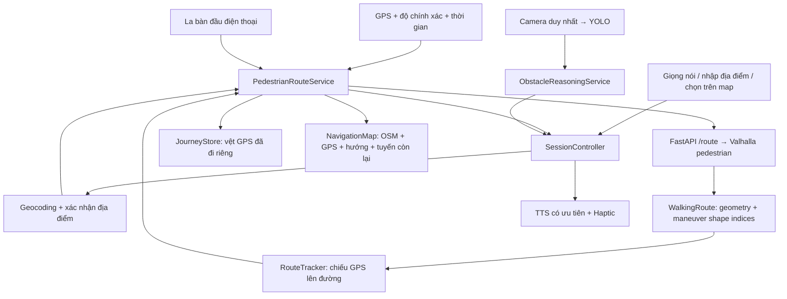

# Kiến trúc dẫn đường đi bộ

Cập nhật 14/10/2026. Trạng thái triển khai và hướng dẫn bàn giao: [HANDOFF_PEDESTRIAN.md](HANDOFF_PEDESTRIAN.md).

## Luồng dữ liệu

## Các ranh giới

- `LocationSource`: GPS thật hoặc nguồn fake trong test; kiểm tra quyền, dịch vụ vị trí, stream và fix hiện tại.
- `CompassService`: hướng đầu thiết bị và lọc độ chính xác; navigation làm mượt góc và hết hạn dữ liệu cũ.
- `WalkingRoute`: geometry `[lat,lng]`, khoảng cách tích lũy và các maneuver gắn với chỉ số shape. Client từ chối route ô tô hoặc API cũ thiếu geometry.
- `RouteTracker`: phép chiếu trên segment và cửa sổ tiến độ, khoảng cách ngang tuyến, điểm nhìn trước và cắt phần đường còn lại.
- `PedestrianRouteService`: state machine `locating/idle/planning/navigating/offRoute/poorGps/arrived/error/paused`; định kỳ tính lại đường tới đích từ GPS mới; kiểm soát response cũ bằng generation.
- `JourneyStore`: vệt thực tế, khoảng cách đã đi, ranh giới đoạn và đích còn dở; không ghi đè vệt khi thay tuyến.
- `SessionController`: điều phối voice, route và perception; route không phụ thuộc camera hoạt động. TTS cảnh báo có ưu tiên hơn chỉ dẫn tuyến.
- `NavigationMap`: nền OSM, vị trí thật, vòng sai số, mũi tên đầu điện thoại, hướng lối đi, vệt đã đi, tuyến còn lại và marker đích.

## Tiến độ thích ứng

Maneuver vẫn cần tồn tại để biết nơi rẽ, nhưng tiến độ không dựa vào một bán kính waypoint cố định. GPS được chiếu lên đường; maneuver nào đã qua được xác định bằng khoảng cách dọc polyline. Khoảng cách hướng dẫn cũng tính dọc đường, không lấy đường chim bay tới điểm rẽ.

Ngưỡng vẫn cần để xử lý độ không chắc chắn: lọc GPS, xác nhận lệch tuyến và đến đích. Các ngưỡng này gắn với accuracy, tốc độ hoặc số fix liên tiếp, không đóng vai trò cơ chế chuyển waypoint.

Tuyến được kiểm tra mỗi 5 giây, cập nhật sau 30 giây nếu đã di chuyển >=5 m, hoặc sớm khi lệch tuyến được xác nhận. Chỉ cập nhật đường phía trước, không thay lịch sử đã đi. Không gọi đồng thời các refresh cho cùng đích; thay đích hủy hiệu lực kết quả cũ.

## Hợp đồng server v2

- `GET /health`: health, routing profile, API version.
- `POST /detect`: YOLO như trước.
- `GET /geocode?q=&near_lat=&near_lng=`: địa điểm ưu tiên vùng hiện tại, chờ người dùng xác nhận.
- `GET /reverse?lat=&lng=`: địa chỉ gần vị trí theo yêu cầu.
- `GET /route?from_lat=&from_lng=&to_lat=&to_lng=`: Valhalla pedestrian, geometry và maneuvers đầy đủ.

`VALHALLA_URL` cấu hình server; `AI_SERVER_URL` cấu hình Flutter, ưu tiên dart-define rồi `.env`. Chạy Nominatim proxy một worker để giữ rate limit trong process.

## Lớp trợ lý OpenAI bổ sung

`SessionController → AssistantController → AiAssistantService → /assistant/chat → Responses API` là luồng riêng, không tham gia vòng quyết định GPS/YOLO. Trợ lý đọc snapshot, nhận ảnh hiện tại khi user yêu cầu, dùng tools truy vấn/tìm địa điểm/tạo proposal. Proposal chỉ gọi callback dẫn đường sau xác nhận của người dùng và kiểm tra context lại. AI TTS có ưu tiên thấp nhất.

Backend giữ key trong `ai_server/.env`; Flutter giữ `.env` URL hiện tại và token thiết bị runtime trong secure storage. Endpoint assistant dùng HTTPS, ghép nối/HMAC, rate limit, budget SQLite và bounded tool loop. Chủ động theo sự kiện, opt-in và cooldown; không gửi ảnh/model request mỗi frame. Xem [handoff OpenAI](HANDOFF_OPENAI_ASSISTANT.md) cho giao thức, cấu hình, kiểm thử và giới hạn.

Nút nói chính và text hội thoại cùng gọi `SessionController.handleUtterance → VoiceCommand.parse`: mẫu dẫn đường gốc chạy local trước, phần còn lại đi qua assistant. `AssistantPanel` hiển thị câu trả lời và xác nhận proposal trực tiếp trên màn bản đồ. Ghép nối có nhập/dán/QR, giữ input khi lỗi. QR chỉ chứa enrollment code và không thay URL backend; camera được nhường tạm cho scanner rồi khôi phục YOLO, còn GPS/TTS dẫn đường vẫn chạy. Chi tiết giao thức và vòng đời camera nằm trong handoff OpenAI.

## Giới hạn được giữ rõ

La bàn là hướng đầu điện thoại, không phải hướng cơ thể. Map matching cục bộ không xác định được bên vỉa hè hoặc tầng trong nhà. Đi bộ theo dữ liệu OSM chưa chứng minh tuyến an toàn/tiếp cận cho người khiếm thị. Camera dùng bbox heuristic, chưa có depth, walkable-area hoặc tránh/sang đường tự động. App chưa dẫn đường khi khóa màn hình. Các bước xác minh và tiếp tục được liệt kê trong handoff.
