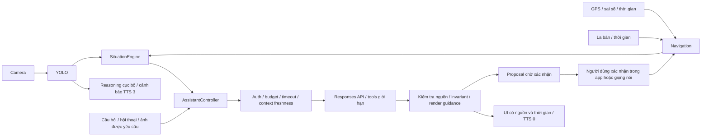

# HTTM Situation-Aware Assistant — 22/10/2026

Đã triển khai mã nguồn theo A → B → C → D trong `HTTM-clean`. Không commit, push, merge, reset hoặc thay `.env`. Đây là báo cáo kiểm chứng bằng unit/widget/integration mock và build; chưa phải nghiệm thu sử dụng thực địa.

## Kiến trúc trước và sau

Trước: `AssistantController` đóng gói GPS/tuyến và một danh sách YOLO; backend chỉ nhận `kind/text`. Regex chặn cả câu khi gặp những từ như “không có”, “không thấy”, “rẽ trái”. YOLO dùng thời gian nhận response làm thời gian quan sát; cảnh báo “rất gần” lấy từ kích thước bounding box. Chủ động chỉ xét trạng thái off-route/error/poor-GPS. Có vật thể liên tục cũng khóa giọng AI liên tục.

Sau: một `SituationEngine` cục bộ dùng chung trong session và assistant tổng hợp nguồn, vùng ảnh, nhóm đối tượng, thay đổi cảnh, waypoint và tình trạng cảm biến. Engine không gọi mạng. Backend kiểm tra lại độ mới và nguồn, tạo phản hồi quan sát/giải thích/khuyến nghị, rồi áp dụng invariant trên từng phần. Navigation vẫn là nơi tạo chỉ dẫn và thực thi hành động sau xác nhận proposal.

## A — Contextual Assistant

- `FinalAnswer`: `information`, `observation`, `situation`, `precaution`, `route_status`, `action_proposal`, `uncertain`; thêm observations/interpretation có nguồn và recommendations là các bước phòng ngừa được cho phép.
- Text kiến thức/hội thoại vẫn tự do. Không còn từ cấm chung “walk/move/không có/không thấy/rẽ trái”. Các mẫu câu khẳng định đường trống, quyền di chuyển, khoảng cách/vận tốc chưa đo được kiểm tra theo mệnh đề và ngữ cảnh sử dụng.
- Mô tả YOLO/GPS/la bàn được render từ dữ liệu thiết bị còn mới; tên nguồn do LLM khai không cho phép tự thêm vật thể hoặc chuyển GPS thành camera. Mô tả ảnh từ model luôn là quan sát tham khảo, không là xác nhận khả năng đi qua.
- Có thể giữ phần “Trong ảnh có xe máy” và bỏ phần “bạn có thể rẽ trái” trong cùng câu. Lời người dùng chỉ được dùng như tình huống có điều kiện.
- Backend trả `guidance` có observations, interpretation, recommendations, evidence_sources, confidence do server gán, priority, requires_confirmation và expiration. `kind` và confidence không cấp quyền thực thi. Confidence không phải xác suất an toàn.
- Mọi round, read tool và render cuối đều kiểm tra freshness; tool output cũ được làm mới trước round kế tiếp. Không gửi lại ảnh đã hết hạn trong tool loop. Không lưu ảnh trong history.
- `route_status` chỉ đọc nguyên chỉ dẫn navigation còn đủ dữ liệu. Proposal luôn thông báo “chưa thực hiện”; không có tool điều khiển người đi bộ hoặc xác nhận sang đường.
- Vẫn giữ bearer/pairing, HTTPS, reservation/settlement SQLite, daily/device budget, timeout, semaphore, giới hạn input/output/round/tool và không retry.
- Schema strict đặt tất cả properties là required, kể cả object lồng nhau. Đã đối chiếu [Structured Outputs](https://developers.openai.com/api/docs/guides/structured-outputs) và [Function calling](https://developers.openai.com/api/docs/guides/function-calling) trong OpenAI Docs. Không đổi model hay estimator giá.

## B — Situation Engine

| Dữ liệu | Xử lý thực tế |
|---|---|
| Detection | TTL 5 giây tính từ **chụp frame**, không từ lúc API trả về; bỏ timestamp tương lai quá 2 giây và kết quả trễ |
| Ảnh AI | TTL 10 giây; chỉ gửi khi người dùng yêu cầu, cache chụp gần nhất vẫn dùng chung camera |
| GPS | TTL 15 giây; chỉ dùng vị trí xác định khi sai số >0 và ≤25 m, không ở poorGps |
| La bàn | Timestamp riêng từ compass, TTL 10 giây; hướng điện thoại không là hướng đi của người dùng |
| Tuyến | Giữ waypoint/index/update time; khoảng cách đến waypoint là khoảng cách tọa độ GPS, không là khoảng cách vật cản |
| Cảnh | Tổng hợp loại/vùng trái-giữa-phải và số lượng; count bucket 1/2/3+ cho thay đổi có ý nghĩa; bỏ dao động confidence/bbox khỏi identity sự kiện |
| Thay đổi | Invalidate quan sát ngay khi cảnh đổi; sự kiện chủ động cần hai mẫu nhất quán; GPS mất/phục hồi, compass mất, nhận diện lỗi và thay đổi tuyến có TTL |
| Liên quan tuyến | Vùng giữa ảnh được ưu tiên chú ý; quan hệ hình học giữa vật thể và tuyến vẫn **chưa xác định** |

`ObstacleReasoningService` vẫn chọn một đối tượng đại diện để giữ API cảnh báo cũ, đồng thời xét nhiều đối tượng, vùng ảnh, nhóm person/vehicle/obstacle/other và tổng hợp scene cho engine. Đã bỏ phát biểu “gần/rất gần” suy từ bounding box. Trường legacy `danger` chỉ còn là heuristic ưu tiên chú ý trong ảnh; không là độ sâu, vận tốc hay xác suất va chạm.

Refresh cùng chỉ dẫn tuyến không tự tạo một route-change notification mới. Đổi waypoint, đổi tuyến, di chuyển quá 10 m, quay la bàn quá 30 độ, nguồn hết hạn hoặc epoch mới đều được xét khi trả lời/xác nhận/đọc giọng các câu phụ thuộc môi trường. Câu kiến thức độc lập vẫn được giữ khi GPS chuyển trạng thái trong lúc request chạy.

## C — Chủ động và giọng nói

- Sự kiện: obstacle, sceneChanged, routeChanged, maneuver, sensorLost, headingUnavailable, gpsRecovered, watchMatch; giữ offRoute/error/poorGps.
- Timer cục bộ 5 giây chỉ xem sự kiện; không gọi model mỗi frame hoặc do cảnh rỗng. Có TTL, priority, dedupe key 10 phút, shared cooldown 120 giây và giới hạn bộ nhớ 30 sự kiện. Backend giữ cooldown 120 giây độc lập.
- Chủ động vẫn mặc định tắt, không gửi ảnh và không được search hoặc tạo navigation proposal. Tắt chủ động hủy kết quả chủ động đang chờ.
- Lệnh rõ ràng “theo dõi xe phía trước”, “theo dõi người phía trước”, “theo dõi vật cản phía trước” đăng ký theo dõi **nhóm đối tượng ở giữa ảnh** trong hai phút. “dừng theo dõi”/“hủy theo dõi” bỏ yêu cầu. Cần bật chủ động và camera nhận diện. Không nhận dạng lại cá thể hoặc đo chuyển động. Watch không tự bật tùy chọn riêng tư của người dùng; vẫn chịu shared cooldown và budget.
- Ưu tiên giữ nguyên: cảnh báo 3 → thao tác/lỗi cảm biến 2 → navigation 1 → AI 0. Cảnh báo mới/escalation cục bộ không chờ model. Cảnh báo giống hệt có cooldown 12 giây; khoảng giữ lời AI chỉ cập nhật lúc thực sự phát cảnh báo, giúp trợ lý có cơ hội giải thích khi cảnh ổn định.
- Nhận diện lỗi/quá trễ có câu báo thiếu dữ liệu cục bộ, tối đa một lần/30 giây và không đọc khi STT đang nghe. Haptic lỗi không chặn cảnh báo giọng nói.
- `speech_text` tối đa 320 ký tự, chọn nguyên câu và dành chỗ cho giới hạn quan sát. UI giữ câu trả lời đầy đủ, nguồn và thời gian tại lúc hỏi.
- Khi TTS ưu tiên cao giữ kênh đến lúc quan sát AI hết hạn: bỏ quan sát cũ. Chỉ phần recommendations do server render có thể được đọc tiếp dưới dạng “Nếu tình huống này vẫn còn…” trong TTL riêng 15 giây, khi ngữ cảnh phù hợp. Không replay thông tin môi trường hết hạn. Đã kiểm thử chỉ đọc một lần.
- Camera, native STT, route service, assistant HTTP và TTS giữ các epoch/lifecycle riêng. QR tiếp tục chờ chụp camera, không chờ network inference; phản hồi YOLO trước QR/pause bị bỏ. Cache JPEG của epoch cũ không được tái sử dụng.

## D — Tích hợp và UX

“Xung quanh tôi có gì?” và các mẫu mô tả môi trường yêu cầu ảnh bằng cùng luồng microphone/typed input. Camera lỗi hoặc ảnh cũ không chặn toàn bộ câu hỏi: gửi các nguồn còn có và yêu cầu nêu giới hạn. Không tự chụp/gửi ảnh cho câu hỏi kiến thức thông thường hoặc sự kiện chủ động.

AssistantPanel trên bản đồ và màn hình hội thoại hiển thị nguồn/thời gian, cảnh báo thông tin tham khảo và proposal chờ xác nhận. Lệnh monitoring có thông báo trạng thái và giọng nói. Quy trình xác nhận proposal từ AI giữ nguyên cho set_destination/refresh_route/cancel_navigation; các mẫu lệnh local rõ ràng đã có vẫn theo hành vi cũ.

Client/backend cần được cập nhật cùng đợt: request thêm các trường optional và event enum; response giữ `text/proposals/expires_at/safety`, bổ sung `speech_text/guidance`. Backend mới vẫn nhận request client cũ; client mới vẫn đọc response cũ không có guidance. Backend cũ strict schema chưa nhận các field/event mới.

## Ví dụ input → output

Các ví dụ dưới đây được chạy qua renderer thật với **sensor và output model giả lập**, không phải kết quả OpenAI hoặc quan sát thực địa. Snapshot JSON ở `build/situation-examples.json` (artifact local, không chứa dữ liệu cá nhân).

| Input/context | Output đã render |
|---|---|
| A: YOLO motorcycle/center còn mới; hỏi cách xử lý | “YOLO: 1 xe máy ở giữa khung hình. Xe có thể ảnh hưởng lối đi; chưa xác định được khoảng trống hai bên. Bạn nên dừng lại để kiểm tra vật cản và khoảng trống xung quanh. Quan sát camera chỉ bao phủ khung hình, không xác nhận an toàn di chuyển.” |
| B: Navigation được mock báo crossing trong 20 m | “Bộ dẫn đường báo: Tuyến trên bản đồ sắp đến điểm sang đường. Hãy kiểm tra vị trí điểm sang đường và tín hiệu giao thông trước khi quyết định.” |
| C: “Xung quanh tôi có gì?”, ảnh còn mới, không có tuyến | “Trong ảnh có xe máy ở giữa và một người bên trái khung hình. Quan sát camera chỉ bao phủ khung hình, không xác nhận an toàn di chuyển.” |
| D: poorGps/sai số 80 m | “Hãy kiểm tra vị trí, chờ GPS ổn định hoặc nhờ người hỗ trợ xác định vị trí. GPS đang báo sai số lớn; vị trí có thể lệch so với thực tế.” |
| E: Chỉ lời người dùng báo xe chắn, chưa có quan sát | “Nếu đúng như tình huống bạn nêu: Xe có thể chắn lối đi; chưa biết khoảng trống hai bên. Bạn nên dừng lại để kiểm tra vật cản và khoảng trống xung quanh. Nếu chưa xác định được lối đi, hãy nhờ người xung quanh hỗ trợ.” |

## File đã sửa/tạo

| Nhóm | File |
|---|---|
| Backend mới | `ai_server/assistant_guidance.py`, `ai_server/test_situation_guidance.py` |
| Backend sửa | `ai_server/assistant_models.py`, `ai_server/assistant_service.py`, `ai_server/detector.py`, `ai_server/test_assistant.py` |
| Flutter mới | `lib/models/situation_context.dart`, `lib/services/situation_engine.dart` |
| Điều phối/API/sensor | `lib/controllers/session_controller.dart`, `lib/controllers/assistant_controller.dart`, `lib/services/assistant_policy.dart`, `lib/services/ai_detection_service.dart`, `lib/services/route_service.dart`, `lib/services/voice_command_router.dart`, `lib/config/ai_config.dart` |
| Reasoning/model/UI | `lib/services/obstacle_reasoning_service.dart`, `lib/models/route_progress.dart`, `lib/models/assistant_state.dart`, `lib/screens/assistant_screen.dart`, `lib/widgets/assistant_panel.dart` |
| Flutter test mới | `test/situation_engine_test.dart`, `test/situation_assistant_test.dart` |
| Flutter test sửa | `test/assistant_test.dart`, `test/device_coordination_test.dart`, `test/home_screen_test.dart`, `test/obstacle_reasoning_service_test.dart`, `test/tts_service_test.dart`, `test/voice_command_router_test.dart` |
| Tài liệu | Báo cáo này, `docs/HANDOFF_OPENAI_ASSISTANT.md`, `docs/RESTORATION_REPORT.md` |

Đã đọc và giữ cơ chế sẵn có trong `assistant_guard.py`, `assistant_router.py`, `assistant_config.py`, `lib/services/assistant_service.dart`, `tts_service.dart` và các tests/context/navigation liên quan; không tạo thêm một auth client, camera stream hoặc TTS scheduler trùng lặp.

## Kết quả kiểm thử thực tế

| Lệnh | Kết quả cuối |
|---|---|
| `flutter analyze --no-pub` | No issues found |
| `flutter test --no-pub` (expanded/compact) | **103/103 đạt** ở lần cuối |
| `ai_server\.venv\Scripts\python.exe -X utf8 -B -m unittest discover -s ai_server -p "test_*.py" -v` | **45/45 đạt** |
| `flutter build apk --debug --no-pub` | Đạt; `build/app/outputs/flutter-apk/app-debug.apk` |
| Secret boundary trên APK | Đạt; quét 598 entries, không chứa backend secret hoặc private state/QR |
| Hash `.env` trước/sau build | Flutter và backend không thay đổi; không in giá trị secret |
| `git diff --check` | Đạt |

Bao phủ mới: hội thoại/kiến thức, từ “không có/không thấy/rẽ trái” hợp lệ, ảnh không rõ, situation không có tuyến, tách clause không có căn cứ, source/kind không cấp quyền xác nhận an toàn, stale/future timestamps, hết hạn trong lúc provider chạy, nhóm nhiều vật thể, thứ tự detections không làm cảnh báo lặp, GPS mất/phục hồi, maneuver, watch expiration, priority/dedupe/cooldown, scene mới hủy câu trả lời cũ, camera lỗi vẫn hỏi được, tắt chủ động hủy kết quả, trì hoãn TTS chỉ giữ precaution, kiến thức không bị GPS update hủy, compass qua hướng Bắc, native TTS race, cảnh báo/GPS/camera hoạt động trong lúc AI treo rồi timeout, và UI có nguồn dữ liệu.

Hồi quy giữ auth/expiry/revoke, pairing/QR, chi phí qua restart, inflight/request-id, bounded tools, proposal xác nhận, detection HTTP deadlines, camera lease/pause/dispose, STT lifecycle, GPS/route và layout. Không skip test; không gọi API AI trả phí. FastAPI TestClient có deprecation warning; test inference cố ý gây exception và log traceback, kết quả HTTP 500 đúng kỳ vọng. Flutter_map có thông báo OSM tile policy trong widget test.

Các lỗi trung gian đã sửa: cache YOLO vẫn còn khi callback báo dữ liệu cũ; scene biến mất không invalidate; lint; tối ưu return sớm camera làm thay đổi hành vi lease và hai regression tests. Giữ pipeline lease cũ, chỉ chặn cache cũ và response cũ; đã chạy lại bộ đầy đủ đạt.

## Giới hạn và phần cần bổ sung

1. Chưa kiểm thử thiết bị hoặc thực địa. Android hiện offline; chưa kiểm chứng độ chính xác camera/YOLO, âm học STT/TTS, haptic, compass và GPS trên điện thoại. Build và mock không thay thế bước này. Không chạy live OpenAI trong phiên.
2. Chưa có depth metric, tracking identity/velocity, camera pose đăng ký với bản đồ, segmentation lối đi hoặc traffic signal verification. Cần cảm biến/depth đã hiệu chuẩn, tracking theo thời gian và thuật toán kiểm chứng riêng trước khi đưa vào evidence. Monocular relative depth không tự trở thành mét.
3. Routing Valhalla hiện chỉ chuẩn hóa `turn/arrive`; chưa có dữ liệu crossing đáng tin cho mọi giao lộ. Engine hỗ trợ ranh giới tích hợp `crossing/crosswalk/intersection` khi provider thực sự cung cấp; ví dụ B là mock contract. Không suy ra điểm sang đường chỉ vì một waypoint là turn. Hiện có thể chủ động báo điểm thao tác tuyến quan trọng, không tự xác nhận giao lộ/đèn xanh.
4. TTL/cooldown là ngưỡng kỹ thuật cần hiệu chỉnh trên thiết bị và thử nghiệm sử dụng. Khi model chậm, phần quan sát có thể bị loại; hệ thống vẫn giữ được thông tin thiếu dữ liệu và bước kiểm tra phù hợp. Lịch sử sự kiện, hội thoại và watch là bộ nhớ ngắn, không phải mô hình thế giới liên tục.
5. Prompt/schema/source checks/claim invariants giảm lỗi nhưng không chứng minh hoàn chỉnh ngữ nghĩa tiếng Việt/Anh; vision/interpretation vẫn có thể sai hoặc diễn đạt vượt kiểm tra. Không có output AI nào được dùng như tín hiệu “đường an toàn” hoặc quyền điều khiển navigation. Cần eval tình huống và kiểm thử người dùng trước triển khai thực tế.
6. TTS priority window hiện dựa trên ước lượng độ dài, chưa có xác nhận completion đáng tin theo từng utterance trên mọi nền tảng. Đã kiểm thử tương thích và race; còn cần đo audio thật. Các cảnh báo build Java native-access và `flutter_tts` KGP là cảnh báo môi trường/plugin hiện có.
7. Muốn xác định chắc chắn vật thể nằm trên tuyến hoặc hướng tránh đi được cần hình học camera–world–map và bản đồ khả năng đi qua còn mới; hiện trả “chưa xác định” và khuyến nghị kiểm tra/nhờ hỗ trợ.

Không tự triển khai backend đang chạy hoặc cài APK vào thiết bị offline. Cần đưa backend và APK mới vào môi trường thử nghiệm cùng nhau trước nghiệm thu.
